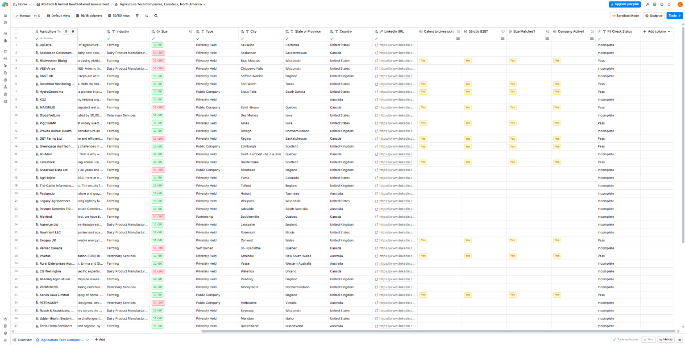
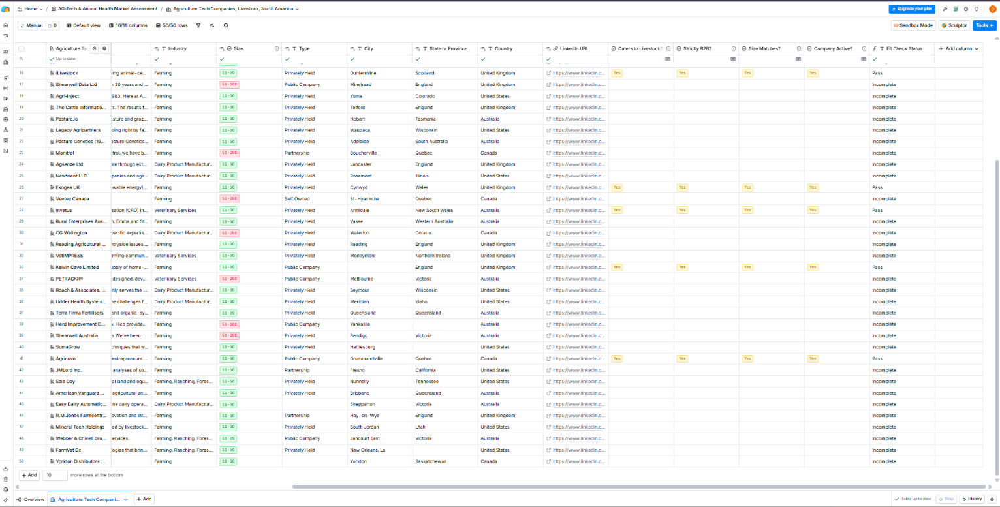

# Project 1: Livestock Ag-Tech ICP and Target Account List

Part 1 of 5 in a GTM pipeline built in Clay: **ICP and account list → lead enrichment → lead scoring → signal-based prospecting → cold email campaign.**

## Goal

Define an ideal customer profile (ICP) for B2B companies that sell to livestock producers, build a target account list in Clay, and measure how well the list fits the ICP **before** spending any enrichment credits.

This is a test build on public company data. There is no client data, so the results below are process metrics (list quality, cost control), not sales outcomes.

## ICP summary

| Field | Rule |
|---|---|
| Who | B2B companies selling software, devices, data or inputs to livestock producers (herd management, livestock monitoring, animal health and nutrition, genetics, marketplaces) |
| Size | 11 to 200 employees |
| Region | United States, Canada, United Kingdom, Australia |
| Stage | Not filterable in Clay search, so headcount and founding date were used as proxies; funding is added after sourcing |
| Activity | Checked by hand (live website, recent post, launch or hire), not a search filter |
| Excluded | Government agencies, nonprofits, educational organizations, consumer pet products, crop-only companies, enterprises, agencies and consultancies, inactive companies |

## Method

1. Wrote the ICP as yes/no rules that can be applied to any row.
2. Sourced companies with Clay's Find Companies search, iterating on the filters.
3. Cleaned the list: deduped, removed non-fits, enforced the region rule.
4. Hand-checked a 20-row sample against the ICP and measured the pass rate.
5. Trimmed the list to the 50 accounts used in the rest of the pipeline.

## Sourcing: how the search evolved

| Iteration | Change | Companies found |
|---|---|---|
| 1 | Industry-led filters (Farming, Ranching, Forestry), B2B, agriculture software subindustries | ~799
      (mostly crop tech and hydroponics) |
| 2 | Added description keywords: livestock, cattle, dairy, swine, poultry, herd, animal health, veterinary |
      ~98 |
| 3 | Broadened industries (biotech research, veterinary, dairy and meat manufacturing, ranching) | ~350 |
| 4 | Narrowed the industry list from 7 values to 4 (for example, removing Ranching) | ~196, then ~148 (142 
      imported) |
| 5 | Re-sourced after the first fit check scored 30% | 103 imported |
| 6 | Re-sourced after the first fit check scored 30% | 103 imported |

**Industry filter, iteration 3 to 4:**

- Before (7 values): Farming, Ranching, Forestry; Biotechnology; Biotechnology Research; Dairy Product Manufacturing; Meat Products Manufacturing; Ranching; Veterinary
- After (4 values): Farming, Ranching, Forestry; Biotechnology Research; Veterinary; Farming
                                          
Search counts are Clay's approximate "found" figures. The imported table counts are the actual numbers.

## Cleaning the final list

| Step | Rows |
|---|---|
| Imported | 103 |
| Duplicate removed (by Domain; 0 duplicates by Name) | -1 |
| Government agencies removed | -2 |
| Nonprofits removed (0 educational) | -4 |
| Companies outside the four target countries removed | -9 |
| Known non-fits from the fit check removed | -5 |
| **Rows after cleaning** | **82** |
| Trimmed to 50 (12 hand-verified passes plus 38 unchecked rows) | **50** |

The 9 out-of-region rows came from New Zealand (3) and one each from Egypt, Israel, Chile, Norway, Ireland and India.

## Fit check

For each sampled company I answered four yes/no questions by reading its website and LinkedIn page: **Caters to Livestock?**, **Strictly B2B?**, **Size Matches?** and **Company Active?** A company passes only if all four are "Yes" and it is in one of the four target countries.

The pass/fail rule is a single Clay formula column, so every row is judged the same way. Blank answers return "Incomplete" instead of counting as failures:

```javascript
!["Yes", "No"].includes({{Caters to Livestock?}}) || !["Yes", "No"].includes({{Strictly B2B?}}) || !["Yes", "No"].includes({{Size Matches?}}) || !["Yes", "No"].includes({{Company Active?}}) ? "Incomplete" : {{Caters to Livestock?}} !== "Yes" ? "Fail: not livestock" : {{Strictly B2B?}} !== "Yes" ? "Fail: not B2B" : {{Size Matches?}} !== "Yes" ? "Fail: wrong size" : {{Company Active?}} !== "Yes" ? "Fail: inactive" : !["United States", "Canada", "United Kingdom", "Australia"].includes({{Country}}) ? "Fail: out of region" : "Pass"
```

### Results

| Sample | Search | Rows | Pass rate |
|---|---|---|---|
| 1 | First search (142 rows imported) | 20 | 6 of 20 (**30%**) |
| 2 | Final search (103 rows imported) | 20 | 12 of 20 (**60%**) with the region rule; 14 of 20 (**70%**) on relevance alone |

In sample 2, the failures were 6 "not livestock" and 2 "out of region," so livestock relevance was the main source of misses.

### How the samples were drawn

- **Sample 1:** Clay Sandbox's default first 10 rows plus 10 rows I added by hand.
- **Sample 2:** I deleted the pre-loaded Sandbox rows and imported 20 miscellaneous rows for the check.

Neither draw was a fully random sample.

## Lessons learned

1. **Industry labels are too broad for a niche.** "Farming" pulled in crop tech, hydroponics and more. Description keywords describe what a company actually does, so they became the main filter.
2. **The location filter matched any office, not headquarters.** Companies headquartered outside my target countries still appeared, so I added a country check after import.
3. **Check what imported before filtering on it.** In one table the Type column came through blank, so my Government and Nonprofit filter matched nothing. Looking at the column itself found the cause.
4. **Test before you apply.** I built the fit check in Clay's Sandbox, then published it with "Publish and don't run" so nothing ran on the full table.
5. **Plan limits shape the build.** The free plan only opens 50 rows of a table, so I trimmed the list to exactly 50 so nothing was locked.
6. **Clean before you enrich.** Enrichment charges per row, so I removed duplicates, non-fits and out-of-region rows first, and kept Auto-run off.

## Limitations

- A 20-row sample is small. A 60% result could plausibly reflect a true rate anywhere from roughly 40% to 80%, so treat the numbers as estimates.
- The pass rates describe the sourced list **before** cleanup. The final 50 had known non-fits removed, so it is a different, cleaner population.
- 12 of the final 50 accounts are hand-verified. The other 38 are unchecked.
- Sampling was not fully random (see above).

## What I would do next at scale

- Use a larger random sample (around 100 rows) to measure quality more reliably.
- Filter on headquarters country from the start.
- Once the yes/no rules prove reliable by hand, apply them to every row with an AI column and spot-check its output.

## Cost and effort

- Credits used for this project: 0 (starting balance 1,000, ending balance 1,000). Sourcing, cleanup and the fit check were done without spending credits.

## Screenshots




## Next

Project 2 enriches these 50 accounts: finding decision-makers and testing email-finding on a small sample before scaling.
