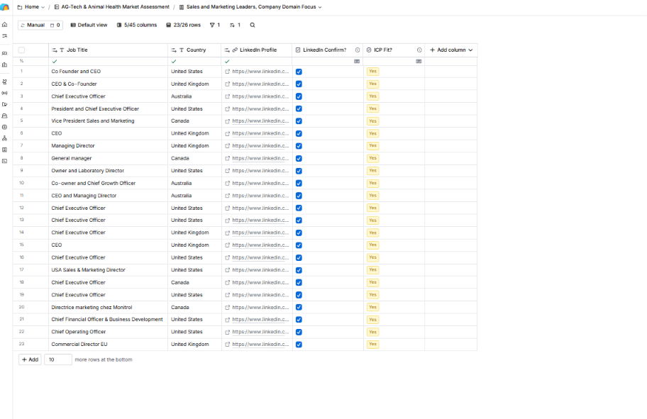

# Project 2: Lead Enrichment (Decision-Makers and Work Emails)

Part 2 of 5 in a GTM pipeline built in Clay: ICP and account list → **lead enrichment** → lead scoring → signal-based prospecting → cold email campaign.

## Goal

Turn the 50-account list from [Project 1](../project-1-icp-account-list) into named decision-makers with work emails, and measure coverage, accuracy and cost.

This is a test build on public company data. **No names, emails or LinkedIn URLs are stored in this repo.** Only counts and screenshots with personal data blurred are included.

## Target personas

Chosen by who owns revenue and growth at a small livestock-tech vendor. At companies under about 30 people, that is often the founder.

| Priority | Persona | Titles that count as a match |
|---|---|---|
| 1 | Sales leadership | Head of Sales, VP Sales, Director of Sales, Chief Revenue Officer, Commercial Director, Head of Commercial |
| 2 | Founder or owner | Founder, Co-founder, CEO, Owner, Managing Director |
| 3 | Marketing and growth | Head of Marketing, VP Marketing, Director of Marketing, Head of Growth, CMO |
| 4 | Revenue operations | Revenue Operations, RevOps, Sales Operations |
| 5 | Business development | Head of Business Development, Business Development Manager |

Rule: keep one contact per company, and a result counts only if the person still works there (checked on LinkedIn) and their title fits a row above.

## Method

1. Tested a Clay function that finds people from a company domain alone, on 5 accounts.
2. Switched to Clay's Find People search, which has seniority and job-title filters, matched to my company table by domain.
3. Previewed results before importing, and set limits so the table stayed within the free plan's 50-row cap.
4. Hand-checked every kept contact on LinkedIn and marked an ICP Fit column.
5. Kept one best contact per company and removed the rest.
6. Ran Clay's Work Email waterfall on the kept contacts, with Auto-run off.

## Results

| Metric | Result |
|---|---|
| Companies targeted | 50 |
| Companies with a hand-verified fit contact | **26 (52%)** |
| Emails found | **23 of 26 (88%)** |
| Valid emails (validation provider) | 23 |
| Credits used | **About 20.5 of 1,000** (about 0.8 per contact, including some test rows) |
| Title match in my first 17-person hand check | 15 of 17 (88%) |

The 3 blanks are contacts where no provider returned an email, which is a real result, not an error.

## How the email waterfall works

The waterfall tries email providers in order and **stops at the first valid result**, so later providers only run (and only cost credits) when earlier ones find nothing. In my first test, the contacts with no email went through every provider in the chain and none found one. That is the cost control: I pay for the next lookup only when the previous one comes up empty.

## Lessons learned

1. **Pick tools by their controls.** My first function took only a company domain and had no title filter, so it returned everyone it found, with no way to target sales or marketing roles. I switched to a search with seniority and job-title filters.
2. **Restrict a people search to your own companies.** An unrestricted search returned 30,000+ people. Matching on my company table's domain column fixed it, and previewing before importing caught it before anything was saved.
3. **Seniority alone is not enough.** Even with senior filters, results included board members and finance or technical executives. I reviewed every result against the persona table and kept one best contact per company.
4. **Expect uneven results.** One company returned 11 people and many returned one. Capping people per company and reviewing before keeping contacts kept the table clean.
5. **Plan limits shape the build.** The free plan opens 50 rows per table, so I worked in batches and kept one contact per company.
6. **A clock icon means "out of date," not "wrong."** Clay flags a cell when an input changed after it last ran. I left flagged cells as they were, because re-running costs credits and can change results.

## Limitations

- **Coverage is 52%.** 24 companies have no hand-verified contact, because of strict filters and gaps in the data source.
- **"Valid" is a provider's judgment, not a delivery test.** I did not send any emails, so real bounce rates are unknown until the campaign in Project 5.
- **Persona calls are judgment calls.** A few titles were borderline (for example a COO or a CFO who also handles business development), and I applied one rule consistently.
- **Small sample.** The early title-match check covered 17 people, so treat that percentage as an estimate.

## What I would do next at scale

- Run a broader second pass for the 24 uncovered companies (Manager level, "Head of" titles).
- Add a catch-all and role-inbox check before any sending.
- Automate the persona check with an AI column, and spot-check its output against my hand verdicts.

## Screenshots

## Next

Project 3 scores and tiers the accounts so the campaign can target the best fits first.
