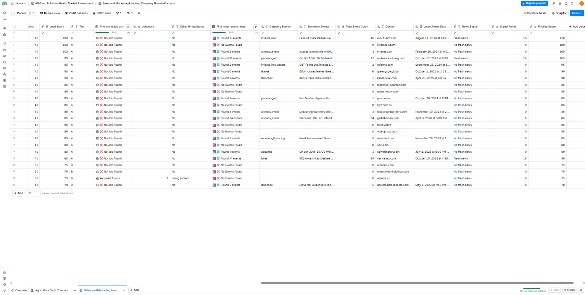

# Project 4: Signal-Based Prospecting

Part 4 of 5 in a GTM pipeline built in Clay: ICP and account list → lead enrichment → lead scoring → **signal-based prospecting** → cold email campaign.

## Goal

Add a timing layer to the score from Project 3. Fit says who a company is. Signals say whether something is happening there right now, such as hiring or fresh news, so outreach can start with the accounts most likely to be in motion.

This is a test build on public company data. **No names, emails or LinkedIn URLs are stored in this repo.**

## Signals and Rules

I defined both rules before looking at any results.

| Signal | Rule | Why |
|---|---|---|
| **Go-to-Market hiring** | At least one open sales, marketing, growth or business-development role | A company hiring for pipeline is investing in it |
| **Fresh News** | A news event found within the last 90 days | A recent event gives a natural reason to reach out |

I used one-time lookups, not Clay's recurring signal monitors, so spending stayed bounded.

**Scoring:** fresh news adds **10 points** for a partnership, launch or expansion, and **5 points** for attending an event. GTM hiring would add points too, but no company qualified. **Priority Score = Lead Score + Signal Points** (it can exceed 100).

## Method

1. Worked in the people table, which has one row per company, and pulled each company's domain into its own column.
2. Tested the hiring lookup on 5 rows, then ran it on the rest.
3. Compared news providers by cost, tested the cheapest on 5 rows, read one full result, then ran the rest.
4. Built a hiring flag, a news-freshness flag, signal points and a priority score as formula columns.
5. Hand-checked a sample of signals against the real sources.

## Results

| Measure | Result |
|---|---|
| Companies checked | 23 (the contacts with an email) |
| Companies hiring for sales, marketing or growth | **0 of 23** |
| Companies with any open job | 1 of 23 (a cost accountant, which is not a go-to-market role) |
| Companies with fresh news (last 90 days) | **3 of 23 (13%)** |
| Companies with no fresh news | 20 of 23 (87%) |
| Companies with news of any age | **3 of 23] |
| Hiring spot-check on LinkedIn | 4 of 4 agreed with the tool |
| News articles hand-checked | 2 of 2 were real |
| Contacts whose rank changed under Priority Score | 3 gained signal points; 7 of 23 changed position; the top-ranked contact
  changed (ties broken alphabetically by company) |

**Credits:** the hiring lookup cost about 0.5 credits, and the news lookup about 11.5 (2.5 for the 5-row test and about 9 for the rest). That is roughly 12 credits for the project, and about 35.6 for the whole build. 

## What the signals tell me

- **Signals are sparse in this niche.** Small livestock-tech vendors rarely post jobs, and most have no recent news. A hiring trigger alone could not carry a campaign here.
- **Fresh news is the usable signal,** and its strength varies. A partnership or launch is a good reason to reach out, while "attends an event" is weaker, so I scored them differently.
- **Relevance still needs judgment.** One fresh partnership was about fertilizer research, which shows activity but not necessarily a livestock need.
- **The signal gives a ready opening line.** Each news event includes a summary sentence that a real campaign could reference in its first line.

## Lessons learned

1. **Compare providers by cost before running.** The same kind of lookup ranged from about 0.5 to over 6 credits a row across menus, so I read the estimate each time and chose the cheapest that looked clean.
2. **Test on 5 rows, read a full result, then scale.** The 5-row test showed how events were structured and what a charge looked like before I spent on the rest.
3. **Define the rule first.** Writing "fresh means 90 days" and "hiring means a sales, marketing or growth role" before seeing results kept me from fitting the rule to the data. It also meant the one open job (accounting) did not count.
4. **Check what a result actually contains.** The extraction helper columns stayed empty, so I read the job title from the cell details instead of trusting a count.
5. **Empty is a result.** Most companies returned nothing, and rows with no result appeared not to be charged. Reporting 0 of 23 is more useful than forcing a signal.

## Limitations

- **Small sample.** 23 companies, so percentages are rough.
- **A snapshot in time.** Signals decay, and these reflect one day.
- **Coverage is unproven for news.** I confirmed hiring results against LinkedIn, but I did not check whether the news source missed real events.
- **Event type and relevance vary,** and my point values (10 and 5) are assumptions.
- **No outcome data.** The Instantly trial ended before anything was sent, so I cannot show that signals improve replies.

## What I would do next

- Refresh signals on a schedule so the timing stays current.
- Add funding or leadership-change signals if a cheap source exists.
- Use the news summary sentence as the first line of a real campaign, and test signal-led openers against generic ones.
- Measure whether signal-based contacts reply more often than the rest.

## Screenshots

## Next

Packaging: a top-level README that ties the five projects into one pipeline story.

