# Project 5: Cold Email Campaign Setup

Part of a GTM pipeline built in Clay and Instantly: ICP and account list → lead enrichment → lead scoring → signal-based prospecting → **cold email campaign**.

## Goal

Turn the scored contact list from Projects 2 and 3 into two audience-specific cold email campaigns, configured for deliverability and compliance, and **built as drafts with nothing sent**.

This is a test build on public company data. **No emails were sent.** No names, emails or LinkedIn URLs are stored in this repo.

## Campaign structure

| Campaign | Audience | Opening email angle |
|---|---|---|
| Livestock AG-Tech Leaders (20 contacts) | Founders, CEOs, owners, managing directors and other executives | Outbound list for their company's market |
| Livestock AG-Tech Sales & Marketing (3 contacts) | Sales, marketing and growth leaders | Pipeline and finding the right buyers |

Both campaigns use the same 3-step sequence: an opening email, a follow-up 2 days later, and a closing email 4 days after that. The follow-up explains my process in one short paragraph. The closing email links to this repository and includes a plain opt-out line.

**Lead lists:** the 23 contacts are split so each sits in exactly one campaign: 20 founders, CEOs, owners and executives in the first, and 3 sales and marketing leaders in the second. My first drafts held the same 23 contacts in both campaigns, which would have emailed everyone twice, so I rebuilt both with separate lists.

**Copy principles:** short plain-text emails, one clear ask (a sample list, then a 15-minute walkthrough), first name and company name as the only merge fields, and **no claims about clients or results**, because I don't have any yet.

## Settings and why

| Setting | Value | Why |
|---|---|---|
| Daily campaign limit | 5 | Conservative for a new sender |
| Send schedule | Office hours, Eastern time | Looks natural |
| Send as text-only (no HTML) | On | Reads like a personal email |
| Open and link tracking | Off | Avoids tracking pixels that can hurt deliverability |
| Stop sending on reply | On (company-level reply stop is off, because each company has only one contact) | Nobody gets follow-ups after replying |
| Unsubscribe link header | On | Gives mail providers a one-click opt-out |
| Bounce protection | On, risky emails not allowed | Protects sender reputation |
| Time gap between emails | 9 minutes plus up to 5 random | Avoids a robotic sending pattern |

## Deliverability checklist

| Check | Result |
|---|---|
| MX | Pass |
| SPF | Pass (single record, well within the lookup limit, ends with a safe "all" mechanism) |
| DKIM | Pass (2048-bit key) |
| DMARC | **Warning:** policy is "none" (monitoring only), reports configured |
| Sender warm-up | **Not started** |
| Real emails sent | **None** |

I checked DNS with a free outside tool, because the sending platform did not show DNS status on the screens I used.

**Reading the DMARC warning:** a "none" policy only monitors, so spoofed mail would still be delivered. The usual path is to read the reports for a few weeks, then move to quarantine, then reject.

## Lessons learned

1. **One sequence, one opener.** My first draft had two different opening emails (one per audience) as Steps 1 and 2, so every lead would have received both. I moved them into two campaigns, one per audience.
2. **Match the waits to the plan.** The default 1-day waits were shorter than my intended rhythm, so I set them to 2 and 4 days.
3. **Split the lead lists before launch.** With two campaigns, a lead in both would be emailed twice, and both of my first drafts held the same 23 contacts. I rebuilt both campaigns with separate lists (20 and 3), so each contact sits in exactly one.
4. **Warm-up comes before volume.** A new mailbox needs a gradual warm-up before campaign sending, which is why I stopped at drafts.
5. **Capture evidence while access lasts.** The trial ended on October 23, so I screenshotted the campaigns, settings and analytics before it closed. My screenshots are the record.

## Limitations

- **Nothing was sent,** so there are no open, reply or bounce results. This project shows setup quality, not outcomes.
- **Sender warm-up had not started** and DMARC is monitor-only.
- **The sending domain did not match this campaign's subject.** A real launch would use a domain that fits the brand and has been warmed up.
- **Compliance is not finished.** Contacts in the UK, Canada and Australia face stricter rules than the US, so a real send would start with US contacts and proper guidance. The footer needs a real postal address. 
- **No signal-based personalization yet.** The follow-up mentions triggers like hiring or funding only in general terms. Project 4 adds real triggers per account.
- **The first account's trial ended on October 23,** so I rebuilt both campaigns, with separate lead lists, in a second account. The sending mailbox stayed attached to the first account, which I could no longer open, so the rebuilt campaigns have no sending account attached. Nothing has been sent from either account.

## What I would do next

- Warm up a mailbox on a matching domain for several weeks before any sending.
- Start with a small US-only batch of the top-scored contacts and review bounces and replies before scaling.
- Add trigger-based opening lines from Project 4 and test two subject lines against each other.
- Tighten DMARC from monitor-only after reviewing its reports.

## Screenshots

Campaign (Leaders)

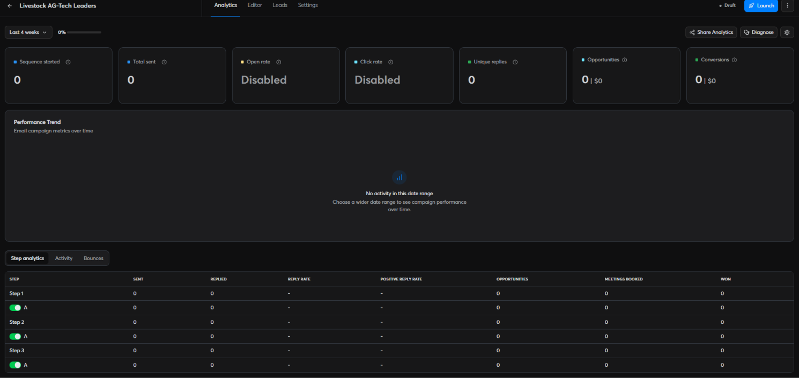
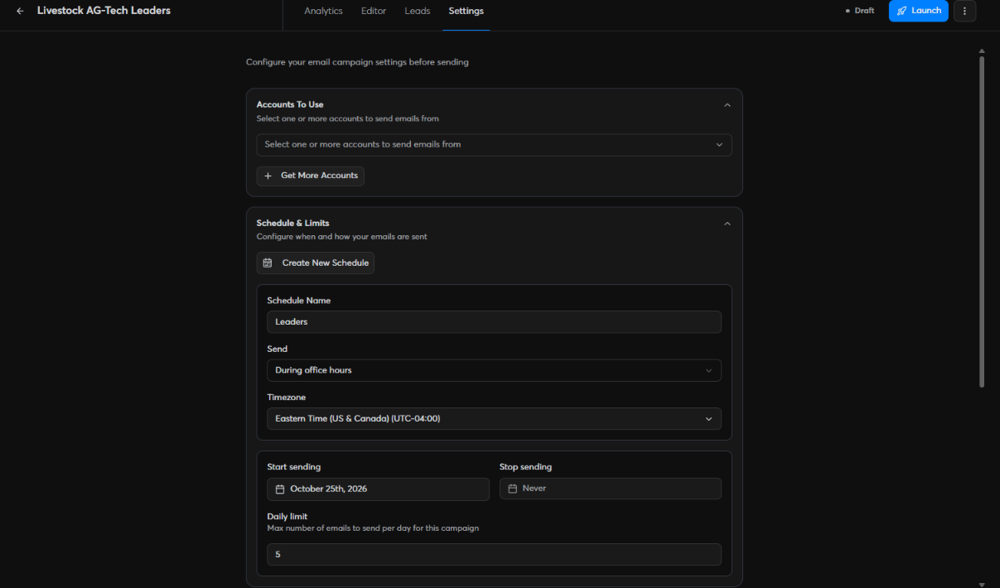
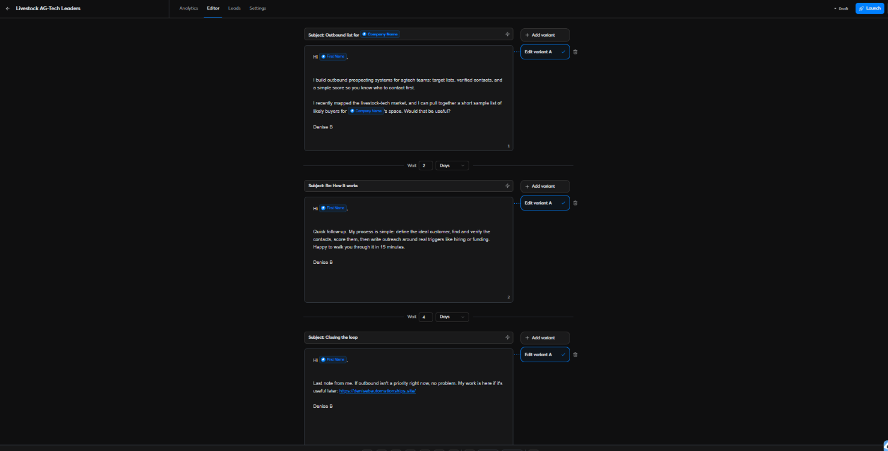
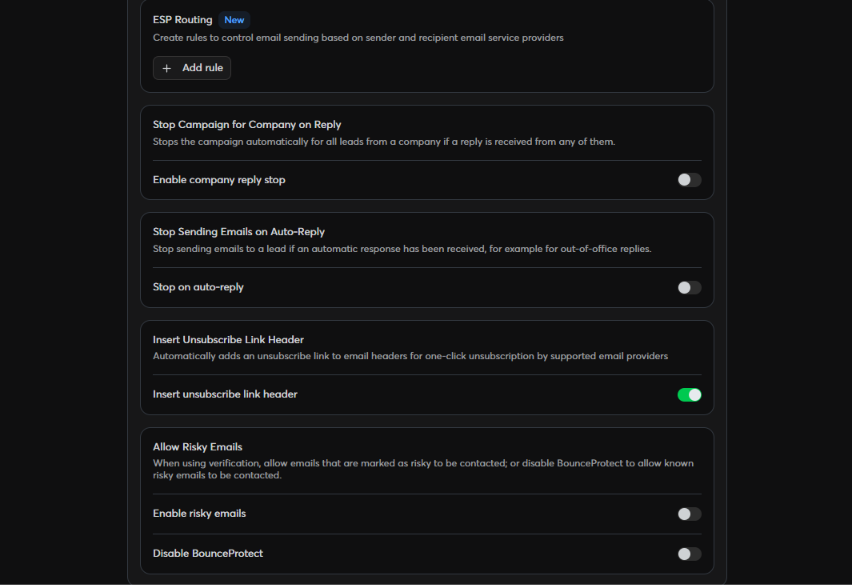
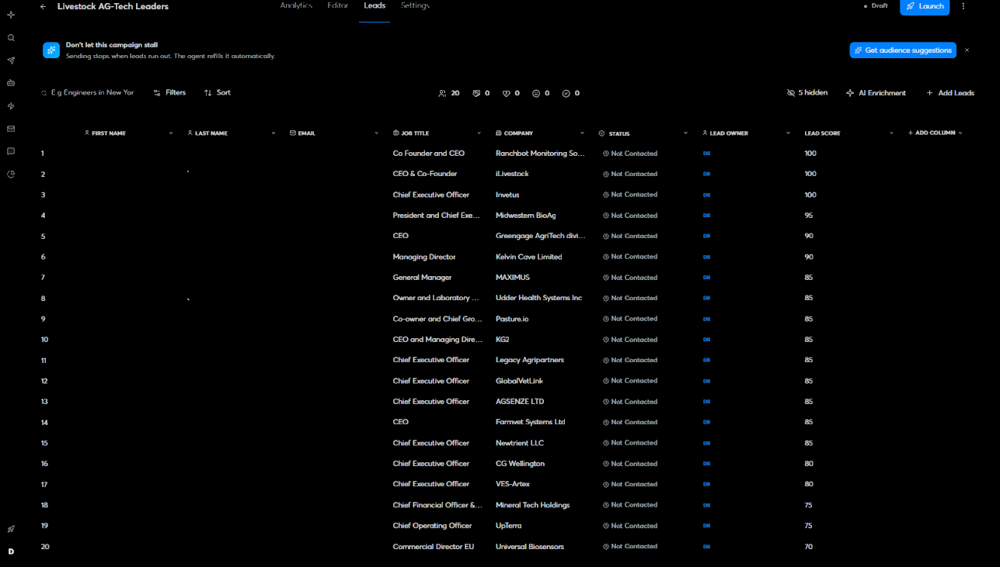
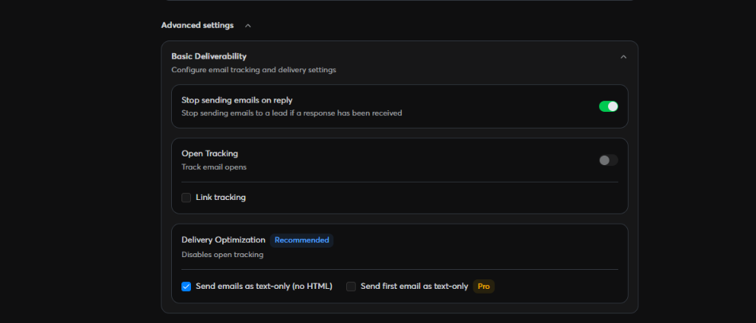

Campaign (Sales & Marketing)

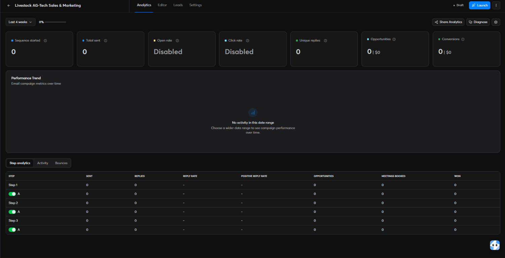
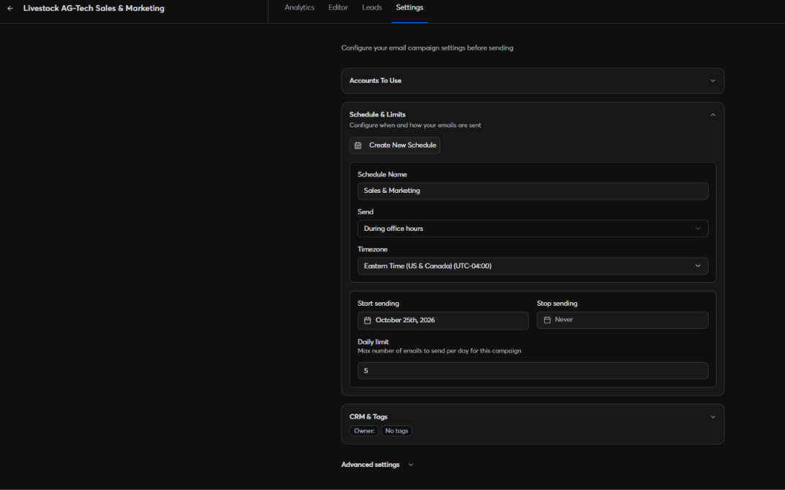
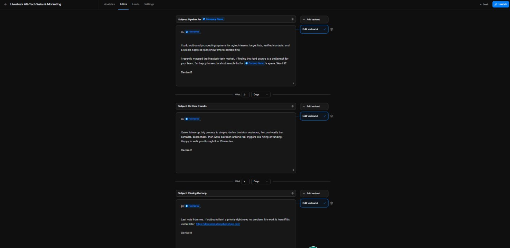
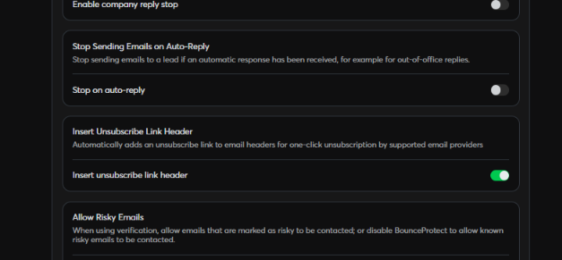
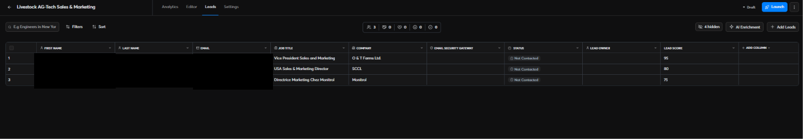
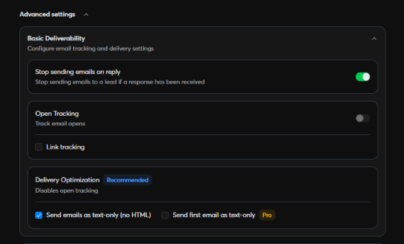

